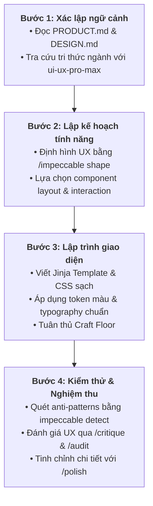

# Hướng dẫn Phối hợp Kỹ năng Thiết kế (AGENTS.md)
<!-- visual-vocabulary-agent:agent-guidelines 1.0 -->

Tài liệu này định nghĩa quy chuẩn làm việc cho các AI Coding Agent (Antigravity, Gemini, Claude Code, Cursor, Codex,...) khi tham gia phát triển, bảo trì và nâng cấp giao diện frontend cho dự án **Visual Vocabulary Agent (VVA)**.

Dự án đã tích hợp sẵn 2 bộ kỹ năng UI/UX mạnh mẽ:
1. **`impeccable`** (`.agent/skills/impeccable/`): Bộ khung tiêu chuẩn chất lượng thiết kế, chống "AI slop", quản trị quy trình (shape, critique, audit, polish) và công cụ quét anti-pattern cơ học (`impeccable detect`).
2. **`ui-ux-pro-max`** (`.agent/skills/ui-ux-pro-max/`): Cơ sở dữ liệu tri thức thiết kế chuyên sâu (80 phong cách UI, 192 bảng màu, 74 cặp font chữ, 120 quy tắc UX) tích hợp công cụ tìm kiếm BM25 (`search.py`).

---

## 1. Phân vai & Nguyên tắc phối hợp (Roles & Synergy)

| Tiêu chí | `impeccable` (Người giám sát & Đạo diễn) | `ui-ux-pro-max` (Thư viện tri thức & Cảm hứng) |
| :--- | :--- | :--- |
| **Bản chất** | Workflow, Quality Floor, Linting, UX Heuristics | Knowledge Base, Token Architecture, Styling Recipes |
| **Nhiệm vụ chính** | Đảm bảo tính hoàn thiện, ngăn chặn thiết kế cẩu thả/cliché, kiểm tra tính khả dụng và khả năng tiếp cận (A11y). | Đưa ra công thức chính xác về mã màu (Hex), cặp font Google Fonts, phong cách trực quan và cấu trúc layout. |
| **Công cụ cốt lõi** | `impeccable context`, `impeccable detect`, `/critique`, `/audit`, `/polish`, `/shape` | `search.py --domain <style\|color\|ux\|typography>`, `search.py --design-system` |
| **Tệp tin quản lý** | `PRODUCT.md`, `DESIGN.md`, `.impeccable/` | `design-system/`, `.agents/skills/ui-ux-pro-max/data/` |

> **Nguyên tắc vàng:**  
> Dùng **`ui-ux-pro-max`** để **tìm kiếm dữ liệu và đề xuất giải pháp trực quan chuẩn xác** (màu, font, phong cách).  
> Dùng **`impeccable`** để **dẫn dắt quy trình, lập kế hoạch, kiểm tra chất lượng và nghiệm thu sản phẩm** trước khi bàn giao.

---

## 2. Quy trình 4 bước chuẩn khi phát triển UI (The 4-Step Workflow)

Mỗi khi nhận yêu cầu tạo mới màn hình, component hoặc tái cấu trúc UI, Agent **bắt buộc** tuân thủ 4 bước sau:



### Bước 1: Xác lập ngữ cảnh & Thiết kế hệ thống (Foundation)
1. **Kiểm tra ngữ cảnh sản phẩm:** Đọc `PRODUCT.md` để nắm rõ người dùng mục tiêu (học sinh, sinh viên tự học tiếng Anh), mục đích ứng dụng (học từ vựng trực quan qua ảnh + chuẩn phát âm).
2. **Tra cứu tri thức thiết kế chuyên biệt:**
   Sử dụng script tìm kiếm của `ui-ux-pro-max` để lấy cảm hứng thiết kế phù hợp cho ứng dụng giáo dục ngôn ngữ:
   ```powershell
   python .agent/skills/ui-ux-pro-max/scripts/search.py "Language Learning App" --domain product
   python .agent/skills/ui-ux-pro-max/scripts/search.py "Language Learning App" --domain color
   python .agent/skills/ui-ux-pro-max/scripts/search.py "Education friendly" --domain typography
   ```
3. **Đồng bộ hóa Design System:** Nếu `DESIGN.md` chưa tồn tại hoặc bị lỗi thời, chạy:
   - `/impeccable document` để ghi lại hiện trạng CSS.
   - Hoặc sinh blueprint thiết kế mới bằng:
     ```powershell
     python .agent/skills/ui-ux-pro-max/scripts/search.py "Visual Vocabulary Agent" --design-system -p "vva" --persist
     ```

### Bước 2: Lập kế hoạch giao diện (Feature Shaping)
1. Chạy quy trình `/impeccable shape <tên_tính_năng>` trước khi code.
2. Trả lời rõ 3 câu hỏi:
   - **User Job:** Người dùng đến màn hình/component này để làm gì?
   - **States:** Đã xử lý đầy đủ các trạng thái chưa? (*Empty state*, *Loading state*, *Error state*, *Success/Interactive state*).
   - **Affordance:** Nút bấm, trường nhập liệu, khu vực tương tác có chỉ dẫn rõ ràng không?

### Bước 3: Triển khai giao diện (Code-First Craft)
1. **Tech Stack chuẩn:** FastAPI + Jinja2 HTML Templates (`frontend/templates/`) + Modular CSS (`frontend/assets/styles/`) + Vanilla JS (`frontend/assets/scripts/`).
2. **Tuân thủ bộ quy chuẩn Craft Floor (`impeccable`):**
   - **Không icon bằng Emoji:** Tuyệt đối không dùng emoji (ví dụ: 📷, 🔊) làm biểu tượng chính thức. Luôn dùng SVG hoặc thư viện **FontAwesome 6** (`fa-solid fa-camera`, `fa-solid fa-volume-high`) đã tích hợp sẵn trong header.
   - **Tương tác chuột rõ ràng:** Tất cả phần tử tương tác (`button`, `a`, thẻ chọn) phải có `cursor: pointer` và hiệu ứng `hover`, `active`, `focus-visible`.
   - **Độ tương phản (WCAG AA):** Độ tương phản giữa chữ và nền phải đạt tối thiểu **4.5:1** cho văn bản thường và **3:1** cho tiêu đề lớn.
   - **Bố cục co giãn linh hoạt:** Không fix cứng chiều cao (`height: 100px`) cho các container chứa văn bản. Text, chip từ vựng, badge điểm phát âm phải tự dàn dòng (flex-wrap/grid) mà không bị vỡ hoặc cắt xén nhãn.
   - **Responsive 4 điểm breakpoint:** 375px (Mobile), 768px (Tablet), 1024px (Laptop), 1440px (Desktop).

### Bước 4: Kiểm thử, Tinh chỉnh & Nghiệm thu (Verification & Polish)
1. **Chạy bộ kiểm tra Anti-pattern cơ học:**
   Sau khi chỉnh sửa HTML/CSS, chạy công cụ detector của `impeccable`:
   ```powershell
   cmd.exe /c .agent\skills\impeccable\scripts\impeccable.cmd detect frontend/templates/<tên_file>.html
   cmd.exe /c .agent\skills\impeccable\scripts\impeccable.cmd detect frontend/assets/styles/<tên_file>.css
   ```
2. **Đánh giá trải nghiệm người dùng (UX Review):**
   - Chạy lệnh nội bộ `/impeccable critique` để rà soát phân cấp thị giác (Visual Hierarchy) và độ phức tạp nhận thức.
   - Chạy `/impeccable audit` để quét khả năng tiếp cận (Accessibility), hỗ trợ bàn phím (`tabindex`, `focus ring`).
3. **Hoàn thiện độ chi tiết (Finishing Touch):**
   - Dùng `/impeccable polish` để căn chỉnh lại padding/margin theo thang nhịp điệu (8px / 16px / 24px / 32px).
   - Dùng `/impeccable bolder` nếu giao diện quá nhạt nhòa, hoặc `/impeccable quieter` nếu có quá nhiều màu sắc cạnh tranh sự chú ý.

---

## 3. Bảng tra cứu lệnh nhanh (Cheat Sheet)

### Lệnh `impeccable` (Thực thi trong phiên trò chuyện Agent)
| Lệnh | Thời điểm sử dụng |
| :--- | :--- |
| `/impeccable init` | Khởi tạo hoặc cập nhật ngữ cảnh sản phẩm trong `PRODUCT.md`. |
| `/impeccable document` | Quét mã nguồn hiện tại và tài liệu hóa Design System vào `DESIGN.md`. |
| `/impeccable shape <màn_hình>` | Lập kế hoạch phân rã màn hình, xác định luồng dữ liệu trước khi code. |
| `/impeccable critique` | Phân tích bố cục, phân cấp thị giác và điểm nghẽn UX của giao diện hiện có. |
| `/impeccable audit` | Kiểm tra tiêu chuẩn kỹ thuật: responsive, A11y, touch-target ≥ 44x44px. |
| `/impeccable polish` | Tinh chỉnh căn lề pixel, bo góc (border-radius), khoảng cách vi mô. |
| `/impeccable bolder` | Làm thiết kế sắc nét, cá tính và ấn tượng hơn khi giao diện bị nhàm chán. |
| `/impeccable quieter` | Giảm bớt kích thích thị giác, hạ tông màu khi giao diện bị rối mắt. |
| `/impeccable clarify` | Rà soát và viết lại microcopy, nhãn hướng dẫn, thông báo lỗi cho người học. |

### Lệnh `ui-ux-pro-max` (Thực thi qua Terminal / Python)
| Câu lệnh | Mục đích tra cứu |
| :--- | :--- |
| `python .agent/skills/ui-ux-pro-max/scripts/search.py "<query>" -d style` | Tra cứu phong cách UI (Claymorphism, Bento Grid, Dark Mode,...) |
| `python .agent/skills/ui-ux-pro-max/scripts/search.py "<query>" -d color` | Lấy mã màu Hex, màu chính (Primary), màu phụ (Accent), màu nền (Background) |
| `python .agent/skills/ui-ux-pro-max/scripts/search.py "<query>" -d typography` | Lấy cặp phông chữ tối ưu và link import Google Fonts |
| `python .agent/skills/ui-ux-pro-max/scripts/search.py "<query>" -d ux` | Lấy các quy tắc và thực hành tốt nhất về trải nghiệm người dùng |
| `python .agent/skills/ui-ux-pro-max/scripts/search.py "<query>" --design-system -p "<ten_du_an>"` | Tạo toàn bộ hệ thống thiết kế tổng thể cho dự án |

---

## 4. Những điều tuyệt đối tránh (Anti-Patterns Blacklist)

1. **AI Slop Clichés:** Không dùng màu gradient tím-hồng ngẫu nhiên làm nền; không lồng thẻ con bên trong thẻ mẹ vô tội vạ (`cards-within-cards`).
2. **Dữ liệu giả thiếu thực tế (Lorem Ipsum):** Không dùng văn bản mẫu vô nghĩa. Với ứng dụng học tiếng Anh VVA, mọi ví dụ phải là từ vựng, phiên âm IPA thật và câu song ngữ Anh - Việt có ngữ cảnh thực tế.
3. **Bỏ quên trạng thái rỗng (Empty State):** Khi người học chưa upload ảnh hoặc chưa có lịch sử học, phải có hình minh họa/hướng dẫn thân thiện thay vì để khoảng trắng hoặc bảng trống.
4. **Vi phạm khả năng tiếp cận (Accessibility):** Tuyệt đối không dùng chữ xám nhạt trên nền trắng khó đọc; không ẩn outline focus của bàn phím mà không có kiểu thay thế tương đương.
5. **Code không responsive:** Không được chỉ test trên màn hình desktop độ phân giải cao; bắt buộc giao diện phải hoạt động tốt trên màn hình điện thoại (mobile viewport).

