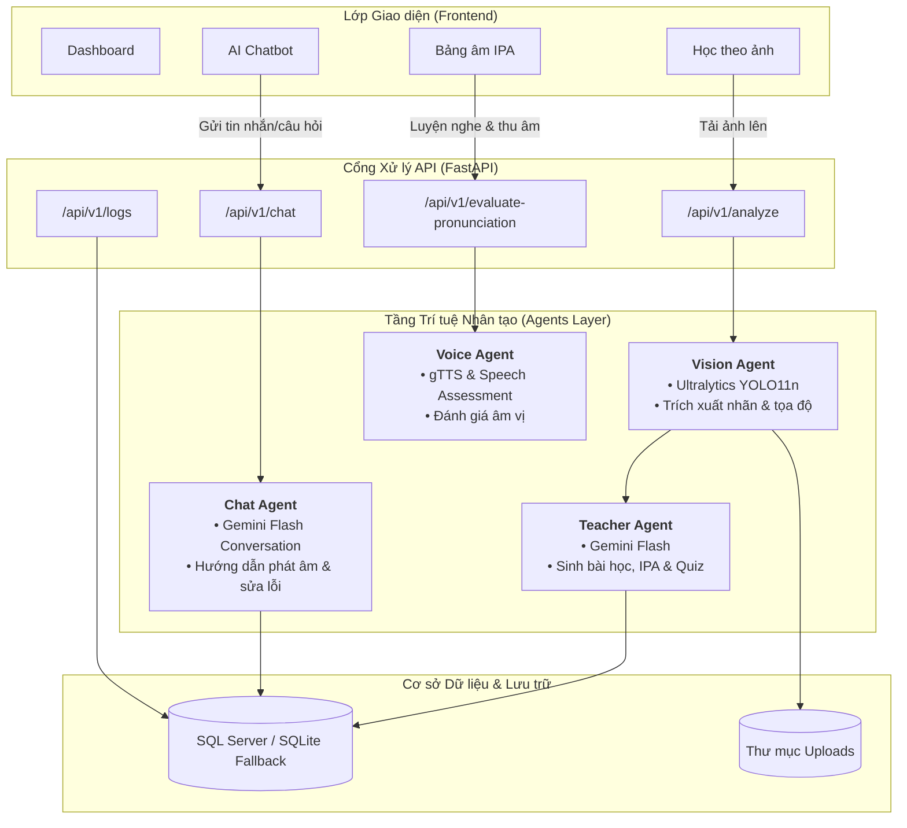

# Visual Vocabulary Agent (VVA) 🎯

<p align="center">
  
  
  
  
  
  
</p>

<p align="center">
  <b>Học từ vựng tiếng Anh trực quan và luyện phát âm chuẩn xác qua Computer Vision và Trí tuệ Nhân tạo Đa tác tử (Multi-Agent AI).</b>
</p>

---

## 📖 Mục lục

- [1. Giới thiệu dự án](#1-giới-thiệu-dự-án)
  - [Bài toán thực tế](#bài-toán-thực-tế)
  - [Giải pháp của Visual Vocabulary Agent](#giải-pháp-của-visual-vocabulary-agent)
- [2. Tính năng cốt lõi](#2-tính-năng-cốt-lõi)
- [3. Công nghệ sử dụng (Tech Stack)](#3-công-nghệ-sử-dụng-tech-stack)
- [4. Kiến trúc hệ thống & Luồng dữ liệu](#4-kiến-trúc-hệ-thống--luồng-dữ-liệu)
- [5. Cấu trúc thư mục dự án](#5-cấu-trúc-thư-mục-dự-án)
- [6. Hướng dẫn cài đặt & Khởi chạy nhanh (Quick Start)](#6-hướng-dẫn-cài-đặt--khởi-chạy-nhanh-quick-start)
  - [Yêu cầu hệ thống](#yêu-cầu-hệ-thống)
  - [Các bước thiết lập](#các-bước-thiết-lập)
- [7. Hướng dẫn sử dụng các phân hệ](#7-hướng-dẫn-sử-dụng-các-phân-hệ)
- [8. Cấu hình Cơ sở dữ liệu & Fallback](#8-cấu-hình-cơ-sở-dữ-liệu--fallback)
- [9. Danh mục API chính](#9-danh-mục-api-chính)
- [10. Lộ trình phát triển (Roadmap)](#10-lộ-trình-phát-triển-roadmap)
- [11. Đóng góp & Bản quyền](#11-đóng-góp--bản-quyền)
- [12. Thông tin liên hệ](#12-thông-tin-liên-hệ)

---

## 1. Giới thiệu dự án

### Bài toán thực tế
Học từ vựng tiếng Anh theo phương pháp truyền thống thường mắc phải hai trở ngại lớn:
1. **Học vẹt thụ động:** Ghi nhớ các danh sách từ ngữ rời rạc không gắn liền với bối cảnh thực tế đời sống, dẫn đến việc nhanh quên và khó ứng dụng khi giao tiếp.
2. **Sai lệch phát âm:** Người học tại Việt Nam dễ phát âm sai do thói quen "đọc bồi" hoặc không nắm chắc phiên âm quốc tế IPA, thiếu phản hồi tức thì để sửa khẩu hình và ngữ điệu.

### Giải pháp của Visual Vocabulary Agent
**Visual Vocabulary Agent (VVA)** biến mọi hình ảnh xung quanh bạn thành một bài học tương tác sống động:
- **Nhìn thấy là học được:** Chỉ cần chụp hoặc tải lên hình ảnh một căn phòng, bàn làm việc hay khung cảnh đường phố, hệ thống Computer Vision sẽ tự động nhận diện các đồ vật.
- **Ngữ cảnh hóa kiến thức:** Trí tuệ nhân tạo (Google Gemini) tức tốc tạo bài học ngữ cảnh gồm từ vựng, phiên âm IPA, định nghĩa, ví dụ thực tế song ngữ Anh - Việt và câu hỏi trắc nghiệm ôn luyện.
- **Chuẩn hóa phát âm đa giác quan:** Nghe audio chuẩn bản xứ (TTS), thực hành nói vào microphone để nhận phản hồi phân tích chi tiết, và tra cứu bảng 44 âm IPA trực quan.

---

## 2. Tính năng cốt lõi

- 📸 **Học từ vựng qua ảnh chụp (Vision Learning):** Nhận diện đa vật thể trong ảnh thời gian thực với mô hình **YOLO11**. Người học có thể chọn từng vật thể để mở bài học chuyên sâu.
- 🎓 **Gia sư AI tạo bài học tức thì (Teacher Agent):** Tự động sinh nghĩa từ, loại từ, cấp độ CEFR (A1-C2), câu ví dụ tình huống và câu đố tương tác (Quick Quiz) kiểm tra độ hiểu bài.
- 🗣️ **Trợ lý Chatbot luyện phát âm & Giao tiếp (AI Tutor Chat):** Trò chuyện đa phương thức, giải thích cặn kẽ cách đặt lưỡi, mở khẩu hình và phân biệt các cặp âm dễ nhầm lẫn (minimal pairs như `/i:/` và `/ɪ/`).
- 🔊 **Bảng tra cứu 44 âm IPA chuẩn quốc tế:** Giao diện trực quan phân chia nguyên âm đơn (monophthongs), nguyên âm đôi (diphthongs) và phụ âm (consonants) kèm âm thanh phát âm mẫu chuẩn xác.
- 🎙️ **Đánh giá phát âm qua giọng nói (Voice Evaluation):** Thu âm giọng đọc của người học, phân tích và phản hồi mức độ chuẩn xác theo từng âm vị mục tiêu.
- 🛡️ **Hệ thống dữ liệu kép an toàn:** Tích hợp SQL Server phục vụ lưu trữ nâng cao, đồng thời hỗ trợ **tự động fallback sang SQLite** khi không có máy chủ CSDL chuyên dụng.

---

## 3. Công nghệ sử dụng (Tech Stack)

| Tầng kiến trúc | Công nghệ | Mục đích sử dụng |
| :--- | :--- | :--- |
| **Backend Framework** | **FastAPI** (Python 3.10+) | API hiệu năng cao, bất đồng bộ (async/await), tự động sinh tài liệu Swagger/OpenAPI |
| **Server Engine** | **Uvicorn** | ASGI Web Server chuẩn cho môi trường Python |
| **Frontend UI** | **Jinja2 Templates + HTML5/CSS3/Vanilla JS** | Giao diện Server-Side Rendering kết hợp tương tác mượt mà, tải trang cực nhanh |
| **Font & Icons** | **FontAwesome 6 + Plus Jakarta Sans** | Bộ icon chuẩn kỹ thuật và typography hiện đại, tối ưu khả năng đọc |
| **Computer Vision** | **Ultralytics YOLO (YOLO11n)** | Mô hình mạng nơ-ron nhận diện vật thể cục bộ tốc độ cao, độ chính xác tối ưu |
| **Generative AI** | **Google Gemini Flash** | Sinh ngữ cảnh bài học, phân tích ngữ nghĩa và tạo phản hồi hội thoại thông minh |
| **AI SDK** | `google-genai` & `langchain-google-genai` | Thư viện kết nối chính thức của Google để giao tiếp với mô hình Gemini |
| **Voice & Speech** | **gTTS (Google Text-to-Speech)** | Chuyển đổi văn bản thành giọng đọc phát âm tiếng Anh chuẩn |
| **Database & ORM** | **SQLAlchemy + pyodbc** | Tương tác CSDL SQL Server, linh hoạt chuyển đổi và fallback SQLite |
| **Configuration** | **python-dotenv** | Quản lý an toàn các biến môi trường và khóa API bí mật |

---

## 4. Kiến trúc hệ thống & Luồng dữ liệu

Dự án áp dụng mô hình **Kiến trúc Đa tác tử (Multi-Agent Architecture)**, trong đó mỗi Agent đảm nhiệm một vai trò chuyên biệt:



### Luồng xử lý chi tiết tính năng Học qua ảnh:
1. **Tiếp nhận:** Người học gửi file ảnh từ camera hoặc thư viện máy lên endpoint `/api/v1/analyze`.
2. **Nhận diện:** `Vision Agent` chạy mô hình `yolo11n.pt` cục bộ, phát hiện các đối tượng (như `laptop`, `cup`, `chair`,...).
3. **Biên soạn bài học:** `Teacher Agent` kết hợp danh sách vật thể với prompt chuyên biệt gửi tới Google Gemini để sinh nghĩa từ, phiên âm IPA, câu ví dụ thực tế và câu đố.
4. **Phản hồi:** API trả về gói JSON hoàn chỉnh để Jinja2 Template hiển thị các thẻ từ vựng trực quan và hộp kiểm tra phát âm.

---

## 5. Cấu trúc thư mục dự án

```text
Visual_Vocabulary_Agent/
├── .agent/                             # Cấu hình kỹ năng AI Agent nội bộ (impeccable, ui-ux-pro-max)
├── backend/                            # Mã nguồn ứng dụng Backend
│   ├── app/
│   │   ├── api/routes/                 # Các API Endpoints chia theo chức năng
│   │   │   ├── chat.py                 # API trò chuyện gia sư AI
│   │   │   ├── learning.py             # API phân tích ảnh & bài học
│   │   │   └── logs.py                 # API truy vấn lịch sử học tập
│   │   ├── core/                       # Cấu hình hệ thống & nạp biến môi trường
│   │   │   ├── database.py             # Quản lý kết nối DB & cơ chế Auto-Fallback
│   │   │   └── settings.py             # Thông số cấu hình chính
│   │   ├── schemas/                    # Pydantic schemas định nghĩa khuôn mẫu dữ liệu
│   │   │   ├── chat.py
│   │   │   └── pronunciation.py
│   │   ├── services/agents/            # Logic nghiệp vụ của các AI Agent
│   │   │   ├── base.py                 # Agent cơ sở tích hợp Gemini
│   │   │   ├── chat.py                 # Agent gia sư phản xạ
│   │   │   ├── teacher.py              # Agent biên soạn bài học
│   │   │   ├── vision.py               # Agent xử lý thị giác máy tính YOLO
│   │   │   └── voice.py                # Agent xử lý giọng nói & phát âm
│   │   ├── utils/                      # Các tiện ích bổ trợ xử lý nội dung
│   │   └── main.py                     # Điểm khởi động ứng dụng FastAPI
│   └── resources/models/               # Trọng số mô hình AI (YOLO11n weight)
│       └── yolo11n.pt
├── database/                           # Script khởi tạo và kiểm tra CSDL
│   └── scripts/
│       ├── create_db.sql               # Script DDL cho Microsoft SQL Server
│       └── test_connection.py          # Script kiểm thử kết nối DB
├── frontend/                           # Giao diện người dùng
│   ├── assets/
│   │   ├── scripts/                    # Client-side JavaScript (app.js, chat.js, ipa.js)
│   │   └── styles/                     # Modular CSS cho từng màn hình
│   ├── static/uploads/                 # Thư mục lưu trữ tạm thời ảnh upload
│   └── templates/                      # Giao diện Jinja2 HTML Templates
│       ├── dashboard.html              # Màn hình chính
│       ├── imagelearn.html             # Màn hình học từ vựng qua ảnh
│       ├── chatbot.html                # Màn hình gia sư AI
│       └── ipa.html                    # Màn hình bảng phiên âm 44 âm IPA
├── training/                           # Dữ liệu phục vụ nghiên cứu & huấn luyện IPA
│   ├── data/raw/                       # File tri thức âm học JSON & TXT
│   └── scripts/                        # Tool thu thập dữ liệu
├── AGENTS.md                           # Quy chuẩn làm việc cho AI Coding Agents
├── CHANGELOG.md                        # Lịch sử thay đổi và phiên bản
├── CONTRIBUTING.md                     # Hướng dẫn đóng góp mã nguồn
├── Dockerfile                          # Cấu hình đóng gói container Docker
├── PRODUCT.md                          # Tài liệu định vị và mục tiêu sản phẩm
├── requirements.txt                    # Danh sách các thư viện Python phụ thuộc
└── README.md                           # Tài liệu tổng quan dự án
```

---

## 6. Hướng dẫn cài đặt & Khởi chạy nhanh (Quick Start)

### Yêu cầu hệ thống
- **Hệ điều hành:** Windows 10/11, macOS, hoặc Linux.
- **Python:** Phiên bản `3.10` trở lên.
- **Git:** Đã cài đặt trên máy.
- **Khóa API:** Cần có `GEMINI_API_KEY` từ [Google AI Studio](https://aistudio.google.com/).

### Các bước thiết lập

#### Bước 1: Sao chép mã nguồn về máy
```bash
git clone https://github.com/your-username/Visual_Vocabulary_Agent.git
cd Visual_Vocabulary_Agent
```

#### Bước 2: Tạo và kích hoạt môi trường ảo (Virtual Environment)
- **Trên Windows (PowerShell):**
  ```powershell
  python -m venv .venv
  .\.venv\Scripts\Activate.ps1
  ```
  *(Nếu gặp lỗi phân quyền script trên PowerShell, hãy chạy lệnh: `Set-ExecutionPolicy -Scope Process -ExecutionPolicy Bypass`)*

- **Trên Windows (Command Prompt):**
  ```cmd
  python -m venv .venv
  .venv\Scripts\activate.bat
  ```

- **Trên macOS / Linux:**
  ```bash
  python3 -m venv .venv
  source .venv/bin/activate
  ```

#### Bước 3: Cài đặt các thư viện phụ thuộc
```bash
pip install --upgrade pip
pip install -r requirements.txt
```

#### Bước 4: Thiết lập biến môi trường
Tạo file `.env` tại thư mục gốc bằng cách sao chép file mẫu:
```bash
cp .env.example .env     # Trên Linux/macOS
copy .env.example .env   # Trên Windows CMD
```
Mở file `.env` và điền khóa API của bạn:
```env
# Bắt buộc: Google Gemini API Key
API_KEY_GEMINI=AIzaSyYourGeminiApiKeyHere

# Tùy chọn: HuggingFace Token (nếu sử dụng thêm model bổ trợ)
HF_TOKEN=your_huggingface_token_optional

# Cấu hình CSDL: Mặc định tự fallback sang SQLite nếu chưa cài SQL Server
DATABASE_URL=sqlite:///./database/english_learning_app.db
```

#### Bước 5: Khởi động ứng dụng Web
Chạy máy chủ Uvicorn ở chế độ hot-reload:
```bash
uvicorn backend.app.main:app --reload --host 127.0.0.1 --port 8000
```

#### Bước 6: Truy cập và sử dụng
Mở trình duyệt web và điều hướng tới:
- 🌐 **Giao diện người dùng:** [http://127.0.0.1:8000/](http://127.0.0.1:8000/)
- 📑 **Tài liệu API tương tác (Swagger UI):** [http://127.0.0.1:8000/docs](http://127.0.0.1:8000/docs)
- 📌 **Tài liệu API thay thế (ReDoc):** [http://127.0.0.1:8000/redoc](http://127.0.0.1:8000/redoc)

---

## 7. Hướng dẫn sử dụng các phân hệ

### 1. Học từ vựng qua ảnh (`/learn-image`)
1. Nhấp vào khu vực tải ảnh hoặc kéo thả một hình ảnh đời thực vào giao diện.
2. Bấm nút **"Bắt đầu phân tích"**. Hệ thống sẽ vẽ bounding boxes quanh các đối tượng nhận diện được.
3. Nhấp vào nhãn vật thể bất kỳ để xem thẻ bài học chi tiết (Phiên âm IPA, ví dụ, nghĩa tiếng Việt).
4. Nhấp nút loa để nghe phát âm mẫu chuẩn xác.

### 2. Trò chuyện cùng Gia sư AI (`/chat-bot`)
1. Đặt câu hỏi về cách phát âm, phân biệt từ vựng hoặc nhờ đặt câu tình huống.
2. Gia sư AI sẽ phân tích lỗi sai thường gặp của người Việt và hướng dẫn chi tiết cách đọc chuẩn từng âm vị.

### 3. Tra cứu & Luyện âm IPA (`/ipa`)
1. Duyệt qua danh sách 44 âm chuẩn quốc tế được phân nhóm màu khoa học.
2. Nhấp vào từng âm để nghe audio phát âm mẫu và xem các từ ví dụ tiêu biểu.

---

## 8. Cấu hình Cơ sở dữ liệu & Fallback

Hệ thống được thiết kế với độ tin cậy cao (**High Resilience**), hỗ trợ cả hai mô hình lưu trữ:

1. **Môi trường Doanh nghiệp / Production (Microsoft SQL Server):**
   - Chạy script tạo bảng hoàn chỉnh tại [database/scripts/create_db.sql](file:///database/scripts/create_db.sql).
   - Điền chuỗi kết nối trong `.env`:
     ```env
     DATABASE_URL=mssql+pyodbc://@localhost\SQLEXPRESS/english_learning_app?driver=ODBC+Driver+17+for+SQL+Server&trusted_connection=yes&TrustServerCertificate=yes
     ```
2. **Môi trường Phát triển / Cục bộ (SQLite Auto-Fallback):**
   - Nếu bạn chưa thiết lập SQL Server, hệ thống sẽ **tự động phát hiện và chuyển đổi sang SQLite cục bộ** (`database/english_learning_app.db`) mà không làm gián đoạn bất kỳ chức năng nào của ứng dụng.

---

## 9. Danh mục API chính

| Nhóm chức năng | Phương thức | Đường dẫn API | Mô tả |
| :--- | :---: | :--- | :--- |
| **Phân tích hình ảnh** | `POST` | `/api/v1/analyze` | Tải ảnh lên, nhận diện vật thể bằng YOLO và sinh nội dung bài học |
| **Đánh giá phát âm** | `POST` | `/api/v1/evaluate-pronunciation` | Upload file ghi âm để chấm điểm phát âm từ vựng |
| **Gia sư AI Chat** | `POST` | `/api/v1/chat` | Trò chuyện với AI Tutor, nhận giải thích phát âm và ngữ pháp |
| **Chat Streaming** | `POST` | `/api/v1/chat/stream` | Stream phản hồi câu trả lời của AI theo thời gian thực |
| **Nhật ký bài học** | `GET` | `/api/v1/logs/learning` | Lấy danh sách lịch sử phân tích ảnh và từ vựng đã học |
| **Nhật ký phát âm** | `GET` | `/api/v1/logs/pronunciation` | Lấy danh sách kết quả luyện đọc và điểm số |
| **Kiểm tra kết nối** | `GET` | `/api/v1/logs/status` | Kiểm tra tình trạng kết nối CSDL và danh sách bảng hoạt động |

---

## 10. Lộ trình phát triển (Roadmap)

- [x] Tích hợp Computer Vision nhận diện vật thể YOLO11n.
- [x] Tích hợp Google Gemini Flash tạo bài học ngữ cảnh và Chatbot gia sư.
- [x] Xây dựng bảng tra cứu 44 âm chuẩn IPA và TTS audio.
- [x] Cơ chế chuyển đổi CSDL linh hoạt (SQL Server $\leftrightarrow$ SQLite).
- [ ] **Theo dõi khẩu hình miệng thời gian thực (Lip-Tracking):** Ứng dụng MediaPipe Face Mesh phân tích chuyển động môi và góc mở hàm khi phát âm qua Webcam.
- [ ] **Thuật toán Lặp lại ngắt quãng (Spaced Repetition System - SRS):** Tự động nhắc nhở ôn tập từ vựng theo đường cong quên lãng Ebbinghaus.
- [ ] **Xác thực người dùng & Đồng bộ đám mây:** Đăng nhập an toàn qua OAuth2/JWT và lưu trữ tiến độ cá nhân hóa.

---

## 11. Đóng góp & Bản quyền

Dự án luôn hoan nghênh và đánh giá cao mọi sự đóng góp từ cộng đồng!
- Vui lòng đọc kỹ tài liệu **[CONTRIBUTING.md](file:///CONTRIBUTING.md)** để nắm rõ quy chuẩn tạo nhánh, commit code (Conventional Commits) và gửi Pull Request.
- Quy chuẩn thiết kế giao diện được tài liệu hóa chi tiết tại **[AGENTS.md](file:///AGENTS.md)**.
- Theo dõi các cập nhật mới nhất qua **[CHANGELOG.md](file:///CHANGELOG.md)**.

Dự án được phân phối dưới giấy phép **MIT License**.

---

## 12. Thông tin liên hệ

Nếu bạn có bất kỳ câu hỏi, thắc mắc hoặc đề xuất cải tiến nào, xin vui lòng liên hệ:

- **Đơn vị phát triển:** Visual Vocabulary Agent Team
- **Email hỗ trợ:** support@visualvocabulary.io
- **Báo cáo lỗi & Đề xuất tính năng:** Mở Issue trực tiếp tại [GitHub Issues](https://github.com/your-username/Visual_Vocabulary_Agent/issues)
- **Cộng đồng thảo luận:** [GitHub Discussions](https://github.com/your-username/Visual_Vocabulary_Agent/discussions)
